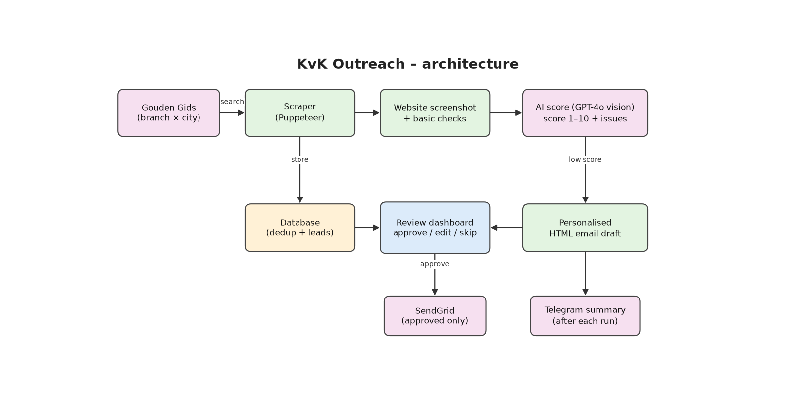

# KvK Outreach

An automated lead-generation pipeline for a web development business. It finds small Dutch companies, takes a screenshot of their website, lets AI judge whether the site needs improvement, and prepares a personalised email — which is only sent after **manual approval** in a dashboard.

## How it works

```
Gouden Gids ──► scraper ──► screenshot ──► AI score ──► review dashboard ──► SendGrid
 (branch × city)  (Puppeteer)   (Puppeteer)   (GPT-4o vision)   (approve / edit / skip)
                                                                         │
                                                              Telegram summary
```

1. **Find companies** – every day a rotating set of branch × city combinations (35 branches × 30 cities) is searched on Gouden Gids with Puppeteer. Results are deduplicated against the database.
2. **Screenshot & checks** – each company website is opened in a headless browser; a screenshot is taken and basic checks run (e.g. mobile viewport meta tag).
3. **AI scoring** – the screenshot is sent to GPT-4o, which returns structured JSON: a score from 1–10, a reason, a list of issues and whether the company is worth contacting.
4. **Email draft** – for low-scoring sites (or companies without a website) a personalised HTML email is generated, mentioning the concrete issues found.
5. **Review** – a small dashboard shows every lead with its screenshot, score and draft. Drafts can be edited, approved or skipped.
6. **Send** – approved emails are sent through SendGrid and marked as emailed.
7. **Notify** – after each run a summary is sent to Telegram.

## Architecture



## Tech stack

| Part | Technology |
|---|---|
| Runtime | Node.js (ES modules) |
| Scraping & screenshots | Puppeteer (puppeteer-extra) |
| AI | OpenAI GPT-4o (vision, JSON output) |
| Database | PostgreSQL (Neon serverless) |
| API & dashboard | Express 5, vanilla HTML/JS |
| Email | SendGrid |
| Notifications | Telegram Bot API |

## Project structure

```
jobs/pipeline.js    # daily pipeline: fetch → screenshot → score → save for review
src/goudengids.js   # Gouden Gids scraper
src/searches.js     # rotating branch × city search combinations
src/scraper.js      # website screenshot + checks
src/scorer.js       # AI website scoring
src/mailer.js       # email templates and SendGrid sending
src/db.js           # leads table and queries
src/api.js          # REST API + serves the dashboard
src/telegram.js     # Telegram notifications
dashboard/          # review dashboard
test-mail.js        # sends two test emails to yourself
```

## Getting started

```bash
npm install
cp .env.example .env   # fill in your keys
```

Run the pipeline (set `USE_MOCK=true` to test with mock data first):
```bash
npm run pipeline
```

Start the API and review dashboard:
```bash
npm run server         # http://localhost:3001
```

## What I learned

- Building a multi-step data pipeline that can safely be re-run (deduplication, statuses per lead)
- Using a vision model with a strict JSON contract to turn screenshots into structured data
- Keeping a human in the loop: nothing is sent without review
- Making a scraper robust: rotating viewports and user agents, delays between requests, handling unreachable sites
